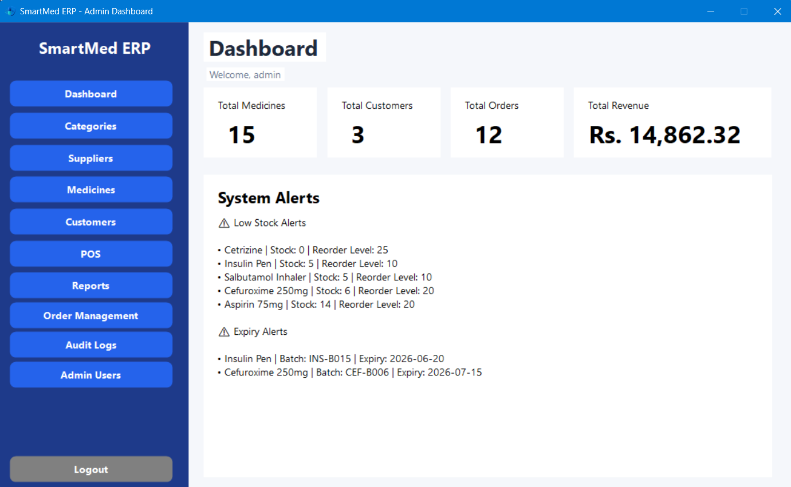

# SmartMed Pharmacy Management

A C# desktop application for pharmacy inventory, prescriptions, customer orders and invoicing.

Pharmacy staff can maintain the medicine catalogue, review prescriptions and track order status. The customer interface connects medicine browsing and checkout with order tracking. Windows Forms handles interaction, while service and repository classes separate business rules from SQL Server access.

**Technologies**  
C# · Windows Forms · ADO.NET · SQL Server

[Browse application screenshots](docs/screenshots)

## Run locally

On Windows, open `SmartMedERP.sln` in Visual Studio and restore the NuGet packages. Review and run `Database/SmartMedDB.sql` on a local SQL Server instance, then point `Data/Database.cs` at that instance. Build the solution and start the desktop application.

## Author

Maleesha Dewmina Perera
